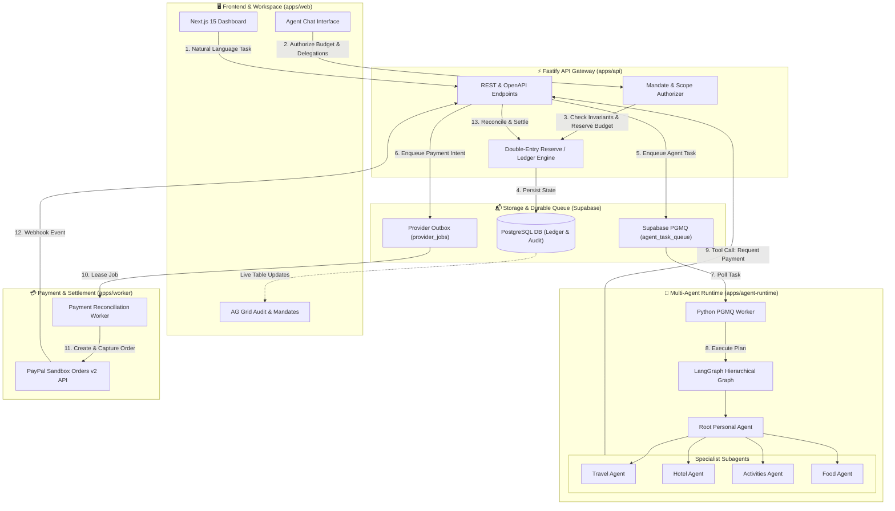

<div align="center">

  

  # PayGuardian

  ### The Delegation Gateway for Bounded, Auditable AI Agent Spending & PayPal Settlement

  <p align="center">
    <b>Empowering autonomous agents to negotiate, plan, and purchase — within cryptographically signed spending mandates, verifiable double-entry ledgers, and real-time human-in-the-loop governance.</b>
  </p>

  <p align="center">
    <a href="https://github.com/payguardian/payguardian/stargazers"></a>
    <a href="https://github.com/payguardian/payguardian/network/members"></a>
    <a href="https://github.com/payguardian/payguardian/blob/main/LICENSE"></a>
    <a href="https://python.org"></a>
    <a href="https://nodejs.org"></a>
    <a href="https://nextjs.org"></a>
    <a href="https://fastify.dev"></a>
    <a href="https://supabase.com"></a>
    <a href="https://developer.paypal.com"></a>
  </p>

  <p align="center">
    <a href="#-system-architecture">Architecture</a> •
    <a href="#-key-features">Key Features</a> •
    <a href="#-sponsor-technologies">Sponsor Tech</a> •
    <a href="#-getting-started">Getting Started</a> •
    <a href="#-operational-modes">Modes</a> •
    <a href="#-security--accounting-invariants">Security & Invariants</a> •
    <a href="#-contributing--license">License</a>
  </p>

</div>

---

## 💡 Overview

As autonomous AI agents evolve from conversational bots into goal-seeking execution systems, granting them unrestricted access to API keys and credit cards is dangerous. A single hallucination or unconstrained loop can drain corporate or personal accounts.

**PayGuardian** solves this problem by introducing a **Bounded Delegation Financial Gateway**:
* **Autonomous Spending Within Guardrails:** Agents can autonomously reserve and execute micro-payments up to strict mathematical thresholds.
* **Human-in-the-Loop (HITL) Passkey Gates:** Any single action or aggregate run exceeding predefined risk thresholds is halted until signed off by human credentials.
* **Zero Secret Leakage:** Prompts never hold credentials, card numbers, or PayPal tokens. All provider calls are routed through isolated execution gateways.
* **Deterministic Double-Entry Ledger:** Guaranteed reconciliation, idempotent transactions, and zero double-spend risks.

---

## 🏛 System Architecture

The following diagram illustrates how user goals flow through the Next.js UI, the Fastify API Gateway, Supabase PGMQ, the LangGraph multi-agent orchestration runtime, and the PayPal Sandbox settlement engine.



---

## 🌟 Key Features

### 1. 🛡️ Bounded Delegation & Scoped Mandates
* Establish parent-to-child agent trust boundaries. A Root Personal Agent can delegate sub-budgets to specialist agents (e.g., flight booking, hotel reservation) with strict constraints on:
  * Maximum currency volume per action.
  * Maximum share of environment budget.
  * Expiration timestamps and maximum delegation depth.
  * Allowed merchant and spending categories.

### 2. 🚦 Human-in-the-Loop (HITL) Passkey Approvals
* Whenever an agent attempts an action that exceeds its single-action autonomous limit, PayGuardian halts execution and raises an interactive approval request.
* The action remains locked in escrow until the human operator signs off or rejects the transaction.

### 3. 💳 Resilient PayPal Sandbox Settlement
* Integrates directly with PayPal's REST Orders v2 API (`/v2/checkout/orders`).
* **Two-Phase Commit:** Funds are authorized and reserved in the internal ledger *before* calling PayPal's order creation.
* Capture is decoupled: reserved ledger balances only move to `CAPTURED` once PayPal confirms `COMPLETED` order status.

### 4. 📊 Enterprise Real-Time Audit Grids (Powered by AG Grid)
* Live, sortable, and filterable transaction tables.
* Deep observability into every state transition: delegations, reservations, release of funds, and provider job lifecycle.

### 5. ⚡ Asynchronous Resilience via Supabase PGMQ
* Decoupled architecture: long-running AI tasks and tool chains do not cause HTTP timeouts on serverless runtimes.
* Tasks are queued into PostgreSQL Message Queues (`pgmq`), allowing background workers to process complex agent reasoning safely with at-least-once delivery guarantees.

---

## 🛠️ Sponsor Technologies & Ecosystem Tools

| Technology | Role in PayGuardian | How It Is Integrated |
| :--- | :--- | :--- |
| **PayPal Developer Platform** | Payment Processing & Settlement | Native integration with the PayPal Sandbox Orders v2 API via `@payguardian/paypal` for idempotent order creation, authorization capture, and webhook event reconciliation. |
| **LangGraph / LangChain** | Agent Orchestration Engine | Powers the hierarchical multi-agent planning loop in `apps/agent-runtime`, orchestrating root and specialist agents with isolated contexts and state recovery. |
| **AG Grid Community & React** | Financial Observability Dashboard | Interactive data tables in `apps/web` rendering the **Activity Audit Ledger** (`ActivityAuditTable.tsx`) and **Mandates Policy Matrix** (`MandatesTable.tsx`). |
| **APIMatic** | API Contract Validation & Docs | Validates OpenAPI 3.1 schemas across Fastify gateway routes to prevent contract drift between the Python runtime, TypeScript client, and frontend. |
| **Supabase** | DB, Auth & Message Queuing | Provides PostgreSQL persistence with Row-Level Security, Supabase Auth, and the `pgmq` queue extension for durable background agent tasks. |

---

## 🚀 Getting Started

### Prerequisites
* **Node.js:** `v22+`
* **Package Manager:** `pnpm v12+`
* **Python:** `v3.11+`
* **Python Tooling:** `uv v0.13+`
* **Docker:** Required if running local Supabase stack

### 1. Clone & Install Dependencies

```bash
# Clone the repository
git clone https://github.com/your-username/payguardian.git
cd payguardian

# Copy environment variables
cp .env.example .env

# Install Node & Python workspace dependencies
pnpm install
uv sync --project apps/agent-runtime
```

### 2. Configure Environment Variables

Edit `.env` and configure your credentials:

```ini
# PayPal Sandbox Credentials
PAYPAL_CLIENT_ID="your_sandbox_client_id"
PAYPAL_CLIENT_SECRET="your_sandbox_client_secret"
PAYPAL_ENVIRONMENT="sandbox"

# Supabase Database & Auth
SUPABASE_URL="https://your-project.supabase.co"
SUPABASE_SERVICE_ROLE_KEY="your_service_role_key"
DATABASE_MODE="supabase"

# LLM Providers (for LangGraph Runtime)
GEMINI_API_KEY="your_google_gemini_api_key"
# or OPENAI_API_KEY="your_openai_api_key"
```

### 3. Launch Services Locally

Run the following commands in separate terminals:

```bash
# Terminal 1: Web Frontend (Next.js 15)
pnpm dev:web

# Terminal 2: API Gateway (Fastify)
pnpm dev:api

# Terminal 3: Agent Worker (LangGraph PGMQ Worker)
pnpm dev:agent_worker

# Terminal 4 (Optional): PayPal Provider Worker
pnpm --filter @payguardian/worker start
```

### 4. Verify Local Endpoints
* **Web Dashboard:** [http://localhost:3000](http://localhost:3000)
* **API Health Check:** [http://localhost:3001/health](http://localhost:3001/health)
* **API OpenAPI Docs:** [http://localhost:3001/docs](http://localhost:3001/docs)

---

## ⚙️ Operational Modes

PayGuardian is architected to operate efficiently both in local development and production scale:

### 1. PayPal Execution Modes
* **`PAYPAL_EXECUTION_MODE=inline` (Default for Local Smoke Testing):**  
  The API handles PayPal order creation and capture synchronously during the HTTP request lifecycle. No standalone worker required.
* **`PAYPAL_EXECUTION_MODE=worker` (Production / Durable Mode):**  
  The API enqueues payment intents into `provider_jobs` with an instant `202 Accepted`. The `@payguardian/worker` daemon leases jobs, manages retries with exponential backoff, and ensures reconciliation even across network blips.

### 2. Agent Execution Modes
* **PGMQ Queue Worker (`pnpm dev:agent_worker`):**  
  Pulls agent tasks asynchronously from Supabase `agent_task_queue`. Recommended for production to prevent Vercel serverless HTTP timeout constraints during multi-step reasoning.
* **HTTP Runtime (`pnpm dev:agent`):**  
  Runs a FastAPI server exposing `/langgraph/run` for direct synchronous invocation during development.

---

## 🔒 Security & Accounting Invariants

PayGuardian is constructed under rigorous zero-trust financial invariants:

1. **Non-Repudiable Authorization:** Every mandate alteration and delegation event is recorded in an append-only audit trail.
2. **Double-Spend Prevention:** Available balance check, debit reservation, and ledger commitment are wrapped in atomic database transactions with row-level locks.
3. **No Prompt Credential Leakage:** Sensitive PayPal tokens and bank identifiers are completely isolated inside the API gateway and never exposed to the LLM agent prompt context.
4. **Idempotency Guarantees:** All payment actions enforce unique `PayPal-Request-Id` idempotency keys derived from SHA-256 action hashes.

---

## 🧪 Quality Assurance & Gates

PayGuardian enforces end-to-end linting, typing, and architectural gate checks:

```bash
# Run complete test suite and code quality checks
pnpm check

# Run Phase 7 Release Readiness audit gate
pnpm release:check
```

---

## 📄 License

This project is licensed under the **Apache-2.0 License**. See the [LICENSE](LICENSE) file for more information.

<div align="center">
  <sub>Built with ❤️ for the future of safe autonomous AI agents.</sub>
</div>
