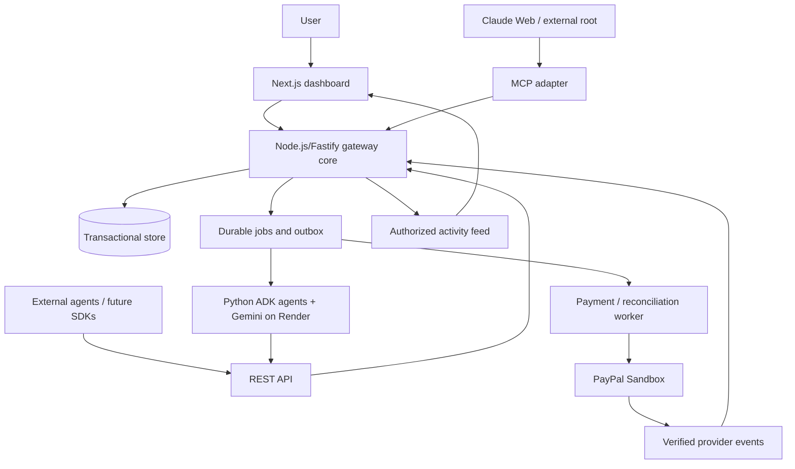

# Step 3: architecture

## Assumptions and open questions
- The user approved this architecture direction; technology selections are recorded separately in `tech.md`.
- Payment-demo currencies and booking/inventory providers remain unresolved.
- Recommendations are design decisions, not claims that components exist or checks have passed.

## System boundary
One authoritative gateway core serves website, REST and MCP operations. Agents propose work; deterministic gateway logic authenticates actors, narrows authority, moves funds and dispatches permitted actions. Gemini cannot grant authority or override denials.

REST/MCP are adapters to the same application operations. The gateway/API is a TypeScript Fastify application deployed as Vercel Functions. The Python ADK runtime is a separate Render service and calls the gateway through authenticated REST/MCP-compatible tool contracts. Keep long-running agent execution outside Vercel request lifetimes.

## Identity and execution
- A user connects a Personal Agent and explicitly authorizes its root mandate.
- For Claude, validated OAuth access binds the user/client connection to the registered root and allowed environments. OAuth authenticates access; it does not attest a model or independently prove that a named child process exists.
- An authenticated parent requests child registration. The gateway verifies parent/environment permissions and creates a distinct child identity linked to the verified issuer.
- The runtime provisions a restricted child credential outside prompts. The parent requests a separate mandate; registration alone grants no budget.
- Platform ADK children authenticate independently. Merely passing `agent_id=hotel` through the root's credential never impersonates Hotel.
- Dynamic spawning selects permitted templates/configured integrations; registration is not permission to execute arbitrary untrusted code.

## Data model
| Record | Core fields/boundary |
| --- | --- |
| Principal, credential, connection | User/agent/service identity; credential lifecycle; OAuth owner/client/root/environment binding. |
| Environment | Owner/membership, purpose, currency, authorized ceiling, lifecycle status. |
| Agent, session, run | Verified parent/root, template/capabilities/status; independent task context references; execution checkpoints. |
| Mandate, policy version | Issuer/holder/parent/environment, signed immutable grant, scope, budget, expiry, depth, approval constraints. |
| Ledger, balance, reservation | Integer minor units; allocation, reserve, capture, release, reclaim; authoritative transactional balances. |
| Action, approval | Immutable request/hash, actor/session/mandate, idempotency key, separate authorization/execution/accounting states; human decision bound to details. |
| Provider operation | Provider IDs, operation-specific retry keys, observed status and reconciliation state. |
| Audit event, job/outbox | Append-only trace and recoverable work persisted with relevant state changes. |

All environment-owned records carry environment scope; reads and writes also check the authenticated principal. Signed grant verification never substitutes for current policy, revocation and balance checks.

## Authority and accounting
Child scope is a subset of effective parent scope; expiry cannot exceed effective ancestor expiry; delegation depth and approval restrictions cannot be weakened. Validate every ancestor, including environment and credential status.

Delegation transfers funds between local balances rather than copying limits. Across an authorized funding envelope:

`authorized funding = sum(local available) + sum(outstanding reservations) + sum(captured spending)`

Hierarchy rollups are derived views, not additional funding. Newly created mandates/sessions do not replenish the environment ceiling. Reclaims and authorized ceiling changes are explicit/audited; pending uncertain payments cannot be reclaimed. This is an authorization ledger, not a deposit account.

## Protected-action lifecycle
1. Authenticate; resolve server-bound identity and environment.
2. Validate schema, request hash/idempotency, complete mandate chain, policies and scope.
3. Atomically reserve funds and persist action, audit and durable work.
4. Obtain required human approval bound to immutable action details.
5. Revalidate authority before final dispatch authorization; never hold a database transaction open across provider HTTP calls.
6. Execute supported provider steps, including buyer approval when required.
7. Persist verified result; capture or safely release reservation. Keep uncertain outcomes reserved until reconciliation.

Track authorization (`denied`, `approval_required`, `allowed`, `invalidated`), execution (`queued`, `awaiting_provider_approval`, `dispatching`, `pending`, `succeeded`, `failed`, `uncertain`) and accounting (`held`, `captured`, `released`) separately.

Revocation and final dispatch authorization share transactional ordering: revocation first blocks dispatch; dispatch first establishes in-flight work requiring reconciliation. Descendants cannot authorize subsequent actions. Revocation does not reverse completed payments.

## Integration surface
Version REST resources under `/v1`; MCP invokes equivalent domain operations with authenticated caller context.

| Resource/workflow | Operations |
| --- | --- |
| Environments | Explicit setup, inspect, pause/resume/close; no implicit creation on routine calls. |
| Sessions and runs | Create, resume, inspect, close; start configured agent work and inspect progress. |
| Agents | Register root/children, inspect hierarchy, rotate/revoke credentials, disable. |
| Mandates and delegation | Request/grant root authority with user consent; narrow delegated grants; inspect effective authority and revoke. |
| Actions and approvals | Request protected work, inspect outcome; human approval/rejection through authorized UI/API only. |
| Budgets and audit | Inspect authoritative balances/history, permitted event queries, action-to-root traces. |

Requests/results use versioned schemas, request IDs and safe machine-readable reasons. REST contract documentation/validation uses APIMatic; SDK generation remains deferred.

## Durability, audit and dashboard
- Persist action changes and durable work atomically; retry delivery and deduplicate consumption. Vercel handles request-serving API functions; durable work must be claimed by a separately deployed worker/queue mechanism and must not depend on a Vercel instance staying alive.
- Bind idempotency keys to authenticated caller/scope and immutable request hashes; use separate persisted provider keys for create/capture.
- Verify provider events, deduplicate and tolerate out-of-order delivery. Never infer payment failure from a timeout.
- Record denied attempts outside rolled-back business mutations.
- Use append-only access restrictions plus hash chaining and independently stored checkpoints for tamper evidence; checkpoint storage/retention is a later operational decision.
- Keep credentials and unnecessary prompt content out of events and feeds.
- Publish committed changes through an authorized feed; support reconnect/catch-up or authoritative snapshot refresh.
- Dashboard covers setup, delegation tree, mandates/policies, sessions/runs, approval inbox, AG Grid agent/transaction/ledger/audit views, and emergency controls.

## External behavior references
- [MCP authorization](https://modelcontextprotocol.io/specification/latest/basic/authorization)
- [ADK documentation](https://google.github.io/adk-docs/)
- [PayPal supported currencies](https://developer.paypal.com/api/rest/reference/currency-codes/): INR is absent; simulation/supported-currency separation awaits user choice.
- [PayPal Checkout](https://developer.paypal.com/docs/checkout/standard/integrate/): respect buyer approval and supported execution flow.
- [PayPal idempotency](https://developer.paypal.com/api/rest/reference/idempotency/): endpoint support/retention varies; persist keys and reconcile uncertain results.
